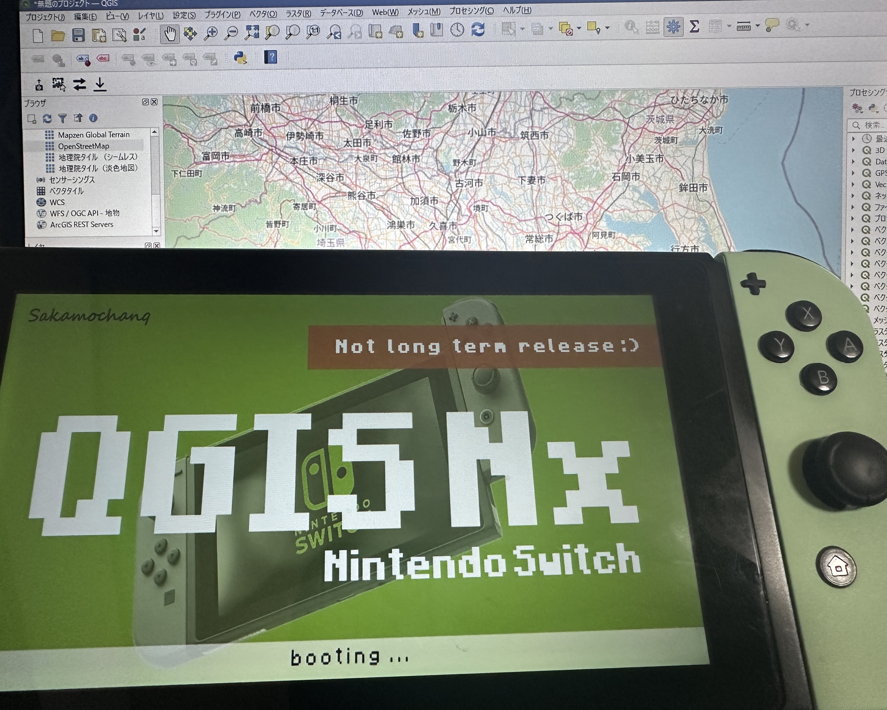

  <h3>qgis-nx</h3>
  
Developing QGIS Nx from scratch (built from the ground up, no porting).

 

  

 
 

### ToDo / Roadmap

#### Core Features & Rendering
- [ ] Render OpenStreetMap (OSM) tiles using cURL
- [ ] Implement layer management
- [ ] Load Shapefiles (.shp) including metadata
- [ ] Render polygons and lines
- [ ] Support Coordinate Reference Systems (CRS)

#### GUI & Controls
- [ ] Create a QGIS-like GUI
- [ ] Implement an attribute table
- [ ] Add Joy-Con controller support

 
 

> [!WARNING]
> This is an unofficial, fan-made project built from scratch,  
> and is not affiliated with, endorsed by, or connected to the official QGIS project.

 

### License

Release under the [GPL-3.0](./LICENSE)

 

### Author

Sakamochanq

 
